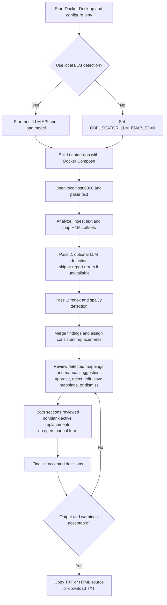

# TO DOs

- Add progress reporting for Pass 1 and Pass 2 (LLM); the UI currently changes only the Analyze button text while processing.
- Add multi-select across mapping groups for faster bulk approval. Per-group Approve all / Reject all and Approve remaining / Reject remaining already exist.
- Clarify any further consolidation needed: findings are already grouped by `(category, quote, replacement)` with expandable per-occurrence review.
- [x] Preserve LLM errors and manual suggestion decisions after review actions; keep overlap statistics in Analysis details.
- [x] Preserve edited replacements when approving findings; support rejecting manual mappings and reopening associated suggestions.
- [x] Separate detected mapping review and manual verification visually on the same page, with counts and a finalization gate for both sections.
- [x] Add per-suggestion Add Mapping / Dismiss actions, duplicate grouping, and links to saved mappings.
- [x] Preview manual replacements and exact occurrences without repeating analysis; allow direct replacement edits in the mapping table.
- [x] Document serial scanner execution, LLM chunking, and CSV recognition from pasted text.
- Restrict the Compose published port to loopback for machine-local use.
- Check replacement generators against intended reserved ranges; current phone and card output does not enforce the previously documented guarantees.
- [x] Add a high-level Mermaid workflow under Notes > Setup.

# My Notes

### Setup
1. Start `Unsloth Studio`
2. Load `gemma-4-E4B-it-GGUF` model with enough context for intended data
3. Start `Docker Desktop`
4. Powershell to project directory `/dataObfuscator/`
5. run `docker compose -f docker/compose.yml up -d`
6. Open web browser and navigate to `http://localhost:8000/`
7. Paste in text data to obfuscate
8. Click `Analyze`
9. Review detected mappings and manual suggestions; approve, reject, edit, save manual mappings, or dismiss suggestions as appropriate
10. Click `Finalize` once both review sections are complete
11. Export obfuscated data via Copy txt, copy html, or download txt options

# AI's Notes

### Setup

1. For Pass 2, start `Unsloth Studio` (or another local OpenAI-compatible LLM server) and enable its API at port `8888`, reachable from Docker. Pass 2 is optional.
2. Load your chosen model, such as your planned `gemma-4-E4B-it-GGUF`, and verify its exact ID through `/v1/models`. Allow enough context for the prompt plus a 2,400-character text chunk and the response; the app does not require a particular model.
3. Start `Docker Desktop`.
4. Open PowerShell in the project root (`dataObfuscator`).
5. Ensure a project-root `.env` file exists (it may be empty); set the server API key if required. Use `OBFUSCATOR_LLM_ENABLED=0` for Pass 1 only. Compose sets the endpoint to `http://host.docker.internal:8888/v1`; edit `docker/compose.yml` if your server uses a different port. For access restricted to this machine, change its port mapping to `127.0.0.1:8000:8000`. Run `docker compose -f docker/compose.yml up -d --build` for the first build or after code changes; otherwise `up -d` is sufficient.
6. Open `http://localhost:8000/` and inspect the LLM status. An offline LLM does not prevent Pass 1.
7. Paste rich text or plain text to obfuscate.
8. Click `Analyze`. The optional LLM runs first, one request per overlapping 2,400-character chunk, then regex and spaCy scan ordinary text. For recognized CSV, spaCy processes unique decoded values in batches before regex scans each unique value. Scanners run serially and inspect original content independently.
9. Review the two numbered sections on the same page. Approve or reject detected groups, edit replacements directly, or expand for individual decisions. For each unique manual suggestion, choose Add Mapping or Dismiss. Verify the prefilled quote/category, inspect matching occurrences, edit the suggested replacement if needed, then Save mapping. Add another mapping handles anything else missed. Custom replacements survive approval, and diagnostics persist across review actions. Bulk remaining actions affect detected findings only.
10. Click `Finalize` when both sections are reviewed, every active replacement is nonblank, and the manual form is saved or canceled. Inspect TXT, HTML, and warnings: unresolved HTML spans retain original text even if TXT was replaced.
11. Export with `Copy TXT`, `Copy HTML` (HTML source as text, for HTML input), or `Download TXT`.

### Input and review reminders

- CSV support recognizes pasted plain text; the app has no CSV upload control. Copy a CSV's contents from a text editor. Recognition requires at least two nonempty rows, at least two comma-separated fields per row, consistent field counts, and valid quoting. Tab-separated clipboard text from Excel uses the ordinary text path; rich HTML uses the HTML path.
- Pending means a mapped finding needs approval or rejection. Unmapped means automatic validation failed; two-character initials can trigger `quote too short` even when present in the input.
- Manual mappings target all exact occurrences, including substrings. The preview uses the same matching rules as finalization and shows up to 20 contexts; it does not call regex, spaCy, or the LLM.
- Review and Finalize do not repeat detection. Only Analyze starts a fresh scan. Overlap statistics describe conflicting detections dropped during merging and are separate from unmapped suggestions.
- Latest implementation verification (2026-10-12): 62 tests and 12 subtests passed; browser checks covered manual review decisions, replacements, and final output using synthetic suggestions.
