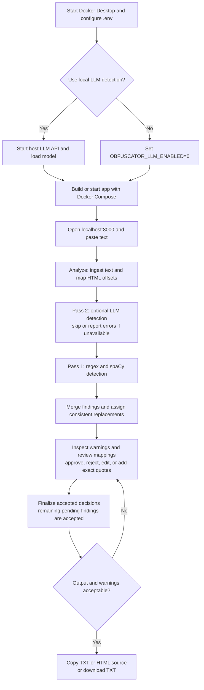

# TO DOs

- Add progress reporting for Pass 1 and Pass 2 (LLM); the UI currently changes only the Analyze button text while processing.
- Add multi-select across mapping groups for faster bulk approval. Per-group Approve all / Reject all and Approve remaining / Reject remaining already exist.
- Clarify any further consolidation needed: findings are already grouped by `(category, quote, replacement)` with expandable per-occurrence review.
- Preserve LLM errors, unverified findings, and overlap warnings after review actions.
- Preserve edited replacements when approving findings, and provide a way to remove manual entries.
- Restrict the Compose published port to loopback for machine-local use.
- Check replacement generators against intended reserved ranges; current phone and card output does not enforce the previously documented guarantees.
- [x] Add a high-level Mermaid workflow under Notes > Setup.

# My Notes

### Setup
1. Start `Unsloth Studio`
2. Load `gemma-4-E4B-it-GGUF` model with enough context for intended data
3. Start `Docker Desktop`
4. Powershell to project directory `/dataObfuscator/`
5. run `docker compose -f docker/compose.yml up -d`
6. Open web browser and navigate to `http://localhost:8000/`
7. Paste in text data to obfuscate
8. Click `Analyze (Pass 1)` button
9. Approve or Reject Mappings
10. Click `Approve decisions & finalize` button
11. Export obfuscated data via Copy txt, copy html, or download txt options

# AI's Notes

### Setup

1. For Pass 2, start `Unsloth Studio` (or another local OpenAI-compatible LLM server) and enable its API at port `8888`, reachable from Docker. Pass 2 is optional.
2. Load your chosen model, such as your planned `gemma-4-E4B-it-GGUF`, and verify its exact ID through `/v1/models`. Allow enough context for the prompt plus a 2,400-character text chunk and the response; the app does not require a particular model.
3. Start `Docker Desktop`.
4. Open PowerShell in the project root (`dataObfuscator`).
5. Ensure a project-root `.env` file exists (it may be empty); set the server API key if required. Use `OBFUSCATOR_LLM_ENABLED=0` for Pass 1 only. Compose sets the endpoint to `http://host.docker.internal:8888/v1`; edit `docker/compose.yml` if your server uses a different port. For access restricted to this machine, change its port mapping to `127.0.0.1:8000:8000`. Run `docker compose -f docker/compose.yml up -d --build` for the first build or after code changes; otherwise `up -d` is sufficient.
6. Open `http://localhost:8000/` and inspect the LLM status. An offline LLM does not prevent Pass 1.
7. Paste rich text or plain text to obfuscate.
8. Click `Analyze (Pass 1)`. Despite the label, this also runs Pass 2 when enabled and available. Internally, the LLM runs before regex + spaCy; the passes are sequential.
9. Inspect analysis warnings and unverified LLM quotes before review actions clear those displays. Approve or reject mapping groups, expand rows for individual edits, and manually add exact missed quotes if needed. Leave custom replacements in the `edited` state; clicking Approve afterward resets them to the default on finalize. Settle pending findings deliberately because finalize accepts any that remain pending.
10. Click `Approve decisions & finalize`. Inspect TXT, HTML, and warnings: unresolved HTML spans retain original text even if TXT was replaced.
11. Export with `Copy TXT`, `Copy HTML` (HTML source as text, for HTML input), or `Download TXT`.

