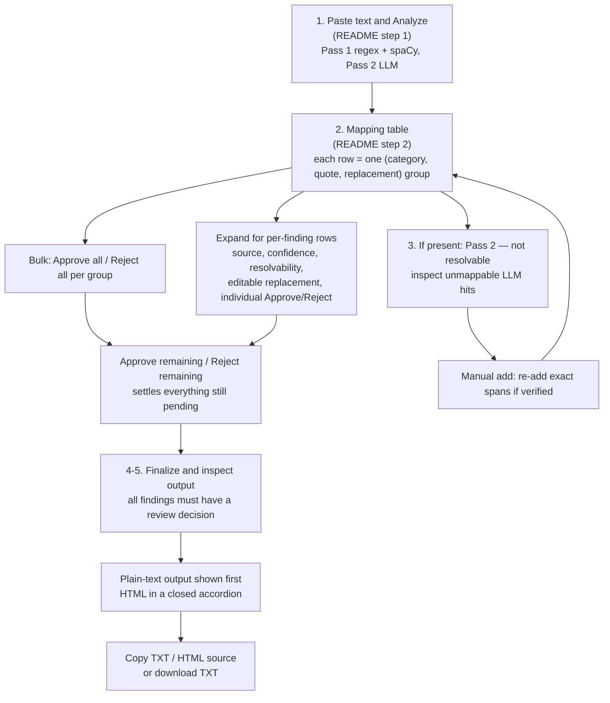

# Data Obfuscator

Single-tenant data obfuscation tool intended for local use. Paste rich text (HTML) or plain text; Pass 1 (regex + spaCy NER) plus optional Pass 2 (local LLM detection only) finds identifying data — emails, phones, IDs, names, orgs, places, business-sensitive free text — and assigns consistent synthetic replacements to detected occurrences. Review the results before exporting; detection is not exhaustive.

## Current implementation

The six planned implementation stages are present in the repository. This describes implemented features, not a guarantee that every original requirement or edge case is covered.

| Step | Scope | Status |
|------|-------|--------|
| 1 | FastAPI skeleton, static UI, Pass-1 regex pass | done |
| 2 | HTML ↔ plain-text offset maps + HTML re-injection | done |
| 3 | spaCy NER, deterministic mapping table, TXT + HTML render | done |
| 4 | Pass 2: local LLM (LM Studio / Unsloth Studio on host) | done |
| 5 | Human-in-the-loop review UI (approve / edit / reject) + finalize | done |
| 6 | Docker packaging + end-to-end polish | done |

## Quick start

```powershell
python -m venv .venv
.venv\Scripts\python -m pip install -r requirements-full.txt
.venv\Scripts\python -m spacy download en_core_web_trf
.venv\Scripts\python -m uvicorn app.main:app
# open http://127.0.0.1:8000
```

Run these commands from the project root. Python 3.12 matches the Docker image; the source uses Python 3.10+ syntax, but installed dependencies must also support your chosen version. `requirements.txt` contains only the web-server dependencies; `requirements-full.txt` supplies the complete runtime. The transformer model and its dependencies require a substantial one-time download. Without an LLM server, regex + spaCy still run and the UI reports Pass-2 unavailability. Set `OBFUSCATOR_LLM_ENABLED=0` to skip the LLM probe and calls.

### Docker (recommended)

```powershell
# Optional: start a host LLM server with an OpenAI-compatible API at :8888/v1
# Compose requires a project-root .env file, even if it is empty.
if (-not (Test-Path .env)) { New-Item -ItemType File .env | Out-Null }
docker compose -f docker/compose.yml up -d --build
# open http://127.0.0.1:8000
```

Start Docker Desktop first. The first build installs the runtime and spaCy model. Use `--build` after source or dependency changes; `up -d` alone reuses the existing image.

Compose connects to `http://host.docker.internal:8888/v1`; the LLM runs separately on the host and must be reachable from the container. Configure the server port and any API key accordingly. With the LLM down, Pass 1 still runs and reports Pass-2 errors.

The checked-in Compose file publishes `8000:8000`, which can expose the unauthenticated app beyond localhost. For access restricted to this machine, change that mapping to `127.0.0.1:8000:8000` before starting it.

Manual Docker without Compose:

```powershell
docker build -f docker/Dockerfile -t data-obfuscator .
docker run -d -p 127.0.0.1:8000:8000 --add-host host.docker.internal:host-gateway --env-file .env -e OBFUSCATOR_LLM_BASE_URL=http://host.docker.internal:8888/v1 data-obfuscator
```

### LLM configuration

Use project-root `.env` entries in `KEY=VALUE` form. For local Python runs, existing process environment variables take precedence. Compose loads `.env` but overrides the base URL and connect timeout with its `environment` entries; edit `docker/compose.yml` to change those two values. Restart the local process or recreate the container after configuration changes.

| Variable | Local default | Purpose |
|----------|---------------|---------|
| `OBFUSCATOR_LLM_ENABLED` | `1` | Only `1` enables Pass 2; use `0` to disable it |
| `OBFUSCATOR_LLM_BASE_URL` | `http://127.0.0.1:8888/v1` | OpenAI-compatible API base; Compose uses the host address above |
| `OBFUSCATOR_LLM_API_KEY` | `lmstudio` | Bearer token; set it to the key required by your server |
| `OBFUSCATOR_LLM_MODEL` | First model returned by `/models` | Optional explicit model ID |
| `OBFUSCATOR_LLM_CONNECT_TIMEOUT` | `10` | Connection timeout in seconds |
| `OBFUSCATOR_LLM_TIMEOUT` | `180` | Request timeout setting in seconds |

The server must support `GET /v1/models` and `POST /v1/chat/completions`. No particular model ID is hard-coded in the app.

## How it works

1. **Ingestion** (`app/ingest.py`) — HTML is tokenized deterministically and mapped to plain text: text runs kept verbatim (1:1 offsets, entities left as-is), `<br>`/block-tag closings insert newlines, `<script>/<style>` content skipped. Any plain-text span maps back to the exact source span — or is reported *unresolved* if it crosses a tag boundary.
2. **Pass 1** (`app/pass1_regex.py`, `app/pass1_ner.py`) — regex for email / phone / SSN / URL / card / IBAN (high confidence), spaCy `en_core_web_trf` for PERSON / ORG / GPE / LOC / FAC (capped confidence, since NER is less precise).
3. **Merge** (`app/render.py`) — identical spans are deduplicated in regex → NER → LLM order. Remaining findings are sorted by `(start, -length, source priority)` and accepted greedily: earlier starts win, then longer spans, then source priority for ties. Confidence does not determine overlap resolution. Each kept finding gets a replacement.
4. **Mapping table** — one entry per unique `(category, quote)`, with occurrence counts. Detected occurrences of the same source string and category receive the same default replacement. After individual reviewer edits, the API table retains the first replacement for that key; the UI separately groups by replacement as well.
5. **Replacements** (`app/namer.py`) — category-specific formatting and pools selected deterministically from a SHA-1 hash of the source string: no state, consistent across sessions while code and pools stay unchanged. Current formats include `(555) xxx-xxxx` phones, `9xx-xx-xxxx` national IDs, Luhn-valid 16-digit card-like values, `XX` account placeholders, and `example.net` / `example.com` domains. These are synthetic values, not a guarantee of universally reserved identifiers. `free_text` is intentionally opaque: `[REDACTED-<hash>]`, editable in review.
6. **Render** — back-to-front replacement applied to plain text directly, and to HTML through the ingest map; unresolvable edits are reported, never guessed.
7. **Pass 2** (`app/pass2_llm.py`) — the optional host LLM detects only, never rewrites. It is prompted for JSON `[{quote, category, confidence, reason}]` for `person | org | place | free_text`; the parser tolerates surrounding prose or code fences. Text is sent in 2,400-character chunks with 240-character overlap. Quotes must match verbatim within their chunk. Stored confidence is `min(0.80, max(0, raw)) * 0.8`, so its maximum is 0.64; confidence is informational and does not control approval or overlap priority. Invalid or unmappable items surface as `llm_unverified` and are never automatically replaced.
8. **Review UI** (`app/static/`) — two sections on the same review page: detected mappings and manual verification. Each mapping group has an editable replacement and group approval/rejection controls; expanding it reveals individual findings. Bulk remaining actions affect detected findings only. Manual suggestions are grouped by quote and category and require Add Mapping or Dismiss. `POST /api/mapping-preview` provides a suggested replacement, occurrence count, and up to 20 contexts without rerunning detection.
9. **Finalize** — `POST /api/finalize` applies submitted decisions, skips rejected ones, and maps manual quotes to all verbatim occurrences. The UI requires all detected findings and manual suggestions to be reviewed, nonblank active replacements, and no open manual form. The API rejects pending or unknown decision statuses. Approving an edited finding preserves its custom replacement. The UI shows plain text first; HTML output sits in a closed accordion.

> **Execution order.** The list above groups responsibilities. In `app/main.py`, ingestion is followed by Pass 2, then regex + NER inside `merge_findings`, then merging, HTML span resolution, mapping, and draft rendering. The passes run sequentially. Diagram labels refer back to the numbered responsibilities above.

```mermaid
flowchart TD
    IN["Input: HTML or plain text"] --> ING["1. Ingestion — app/ingest.py<br/>(README step 1)<br/>tokenize HTML, map to plain text<br/>text runs kept verbatim, 1:1 offsets<br/>br and block closings insert newlines<br/>script/style skipped"]
    ING --> P2
    MERGE --> RES{"Plain-text span maps back<br/>to an exact source span?"}
    RES -->|"crosses a tag boundary"| UNRES["Reported unresolved<br/>surfaces in the review queue"]
    RES -->|"exact or plain-text input"| MT
    UNRES --> MT

    subgraph PASS1["Pass 1 — deterministic"]
        P1["2a. Regex — app/pass1_regex.py<br/>(README step 2)<br/>email, phone, SSN, URL, card, IBAN<br/>high confidence"]
        P1B["2b. NER — app/pass1_ner.py<br/>(README step 2)<br/>spaCy en_core_web_trf<br/>PERSON, ORG, GPE, LOC, FAC<br/>capped confidence"]
    end

    subgraph PASS2["Pass 2 — local LLM, detects only"]
        P2["3a. Optional app/pass2_llm.py<br/>(README step 7)<br/>request JSON: quote, category,<br/>confidence, reason"]
        P2V{"3b. quote found verbatim<br/>in its chunk?"}
        P2U["llm_unverified<br/>never auto-replaced"]
        P2 --> P2V
        P2V -->|"no"| P2U
        P2V -->|"yes, or LLM skipped / unavailable"| P1
        P2U --> P1
    end

    P1 --> P1B
    P1B --> MERGE
    MERGE["4. Merge — app/render.py<br/>(README step 3)<br/>deduplicate and resolve overlaps<br/>earlier start, longer span, then source priority<br/>attach deterministic synthetic replacements"]
    MT["5. Mapping table<br/>(README steps 4-5)<br/>one entry per unique (category, quote)<br/>with occurrence counts"]
    MT --> RENDER["6. Render<br/>(README step 6)<br/>back-to-front replacement<br/>plain text direct, HTML via the ingest map<br/>unresolvable edits reported, never guessed"]
    RENDER --> UI["7. Review UI — app/static/<br/>(README step 8)"]
    P2U --> UI
    UI --> FIN["8. Finalize — POST /api/finalize<br/>(README step 9)<br/>all findings require a decision<br/>approved/edited applied, rejected skipped<br/>manual quotes mapped to all verbatim occurrences<br/>returns TXT + HTML"]
```



## Consistency guarantee

If all 20 occurrences of "John Smith" are detected under the same category, they receive the same default replacement, including after a restart with unchanged code and pools. This does not guarantee detection of every occurrence, recognition of aliases or case variants as the same identity, or unique replacements for different source strings. Per-occurrence reviewer edits can intentionally break default consistency.

## Review workflow

1. Paste text → **Analyze** to run regex + spaCy and the optional LLM.
2. **Review detected mappings**: edit replacements directly, use `Approve all` / `Reject all` per group, or expand (`▸`) for individual decisions. `Approve remaining` / `Reject remaining` settle pending detected findings only.
3. **Manual verification**: choose Add Mapping or Dismiss for each unique suggestion. Add Mapping prefills the quote and category; inspect exact occurrences and edit the suggested replacement before Save mapping. Add another mapping handles anything the scans missed. Manual mappings replace all exact occurrences, including substrings inside longer text.
4. Finalize stays disabled until both sections are reviewed and every active mapping has a replacement. Reopen a suggestion to reconsider it. Rejecting its manual mapping reopens the suggestion; approving it again restores the mapping decision. Overlap statistics appear in Analysis details.
5. **Finalize** → inspect plain text, HTML, and warnings. Copy TXT, copy HTML source, or download TXT. HTML is available only when the submitted input was HTML; Copy HTML copies markup as a text string, not a rich clipboard payload.

Plain-text pastes (including CSV copied from Notepad) use the text input path, so browser-generated line-break tags do not encode ampersands or angle brackets as HTML entities. Copy TXT copies the final text without adding quotes or otherwise serializing it. CSV field quotes already present in the input remain necessary for commas, embedded quotes, and multiline values.

Comma-separated text with at least two nonempty rows and a consistent field count is recognized as CSV. Regex and spaCy scan each unique decoded field independently; spaCy uses batches. The LLM receives unique decoded field values separated by blank lines, and its findings must map wholly into a single value. Findings map back to every matching field in the original CSV, including doubled quotes and multiline values. Replacements stay within a single field, and replacement commas, quotes, or newlines are escaped as CSV data. Unsafe or unmappable findings are listed for manual review; their warnings remain visible as decisions change. Manual quotes match decoded field content.



## API

- `GET  /api/health` — app status + named passes + LLM availability/model; does not load or verify the spaCy model
- `POST /api/analyze` — `{html?, text?}` → `plain_text`, findings (with `replacement`, and `source_span` for HTML input), mapping table, `html_preview`, `txt_preview`, `html_out`, `unresolved_render_edits`, `llm_unverified`, `llm_errors`, `dropped`
- `POST /api/finalize` — `{html? | text?, decisions[]}` → `{html, txt, mapping_table, applied, dropped, warnings}`

When both inputs are supplied, nonempty `html` takes precedence over `text`. Decisions use character offsets in the ingested plain text, not the HTML source. A manual decision uses `start: null`, a nonempty exact quote, category, and status. Detected decisions include `start` and `end`; use status `edited` with a replacement to override the default.

The app is unauthenticated and has no application database or document persistence. Local Uvicorn binds to loopback by default; Docker exposure depends on the published port mapping.

## Privacy notes

- Setup downloads packages, the model, and Docker image layers. During analysis, the app sends plain-text chunks to the configured LLM endpoint; keep that endpoint local to preserve the intended deployment. LLM logging and retention depend on that separate server.
- Every detected finding starts pending, regardless of source or confidence. NER scores are fixed by label: PERSON 0.90, ORG/GPE 0.85, LOC/FAC 0.80. Confidence scores are informational heuristics, not measured probabilities.
- Generated names, organizations, and places may coincide with real entities. Phone output is not restricted to `555-01xx`; card values are Luhn-valid but are not selected from an explicit test-number allowlist.
- HTML is preserved rather than sanitized: attributes, links, scripts, and styles are outside detection. The preview iframe is sandboxed, but copied HTML retains original markup and can reference external resources.

## Current limitations

- HTML entities are kept verbatim in the plain text (they are part of the source substring), which keeps offset alignment exact; detection sees `&amp;` rather than `&`.
- Tags are matched with `<[^>]*>`: a literal `>` inside an attribute value is a known edge case.
- A span that crosses an inline tag is unresolved for HTML rendering. TXT replacements still apply, while the original HTML span remains unchanged. Expanded review rows show `Resolves? no`; finalize returns warnings. The API's `applied` count includes selected spans that may remain unresolved in HTML.
- spaCy NER can miss domain-specific person/org mentions; that is exactly what Pass 2 (local LLM) is meant to catch.
- `free_text` replacements default to opaque `[REDACTED-<hash>]` placeholders; edit the replacement directly in the mapping table or manual form for a readable stand-in.
- The manual preview shows up to 20 contexts; its count includes every matching occurrence. Overlapping final selections can still be skipped; inspect output warnings.
- There is currently no progress bar or multi-group selection.

## Tests

```powershell
.venv\Scripts\python -m pip install pytest
.venv\Scripts\python -m pytest tests -q
```

The full suite needs the runtime dependencies and spaCy transformer model. Pass-2 tests mock the HTTP client; they do not validate a live model's detection quality.
